# livebio action test

A throwaway repository used to check that the livebio GitHub Action works end to end.
It can be deleted once the check has passed.

<!-- livebio:start -->

<picture>
  <source media="(prefers-color-scheme: dark)" srcset="livebio/showcase-dark.svg">
  
</picture>

[GitHub](<https://github.com/illusive7ai>) · [Website](<https://williamportfolio-eosin.vercel.app/>)

<picture>
  <source media="(prefers-color-scheme: dark)" srcset="livebio/showcase-city-dark.svg">
  
</picture>

<picture>
  <source media="(prefers-color-scheme: dark)" srcset="livebio/showcase-chess-dark.svg">
  
</picture>

<a href="https://github.com/illusive7ai/livebio">
<picture>
  <source media="(prefers-color-scheme: dark)" srcset="livebio/credit-dark.svg">
  
</picture>
</a>

<!-- livebio:end -->
